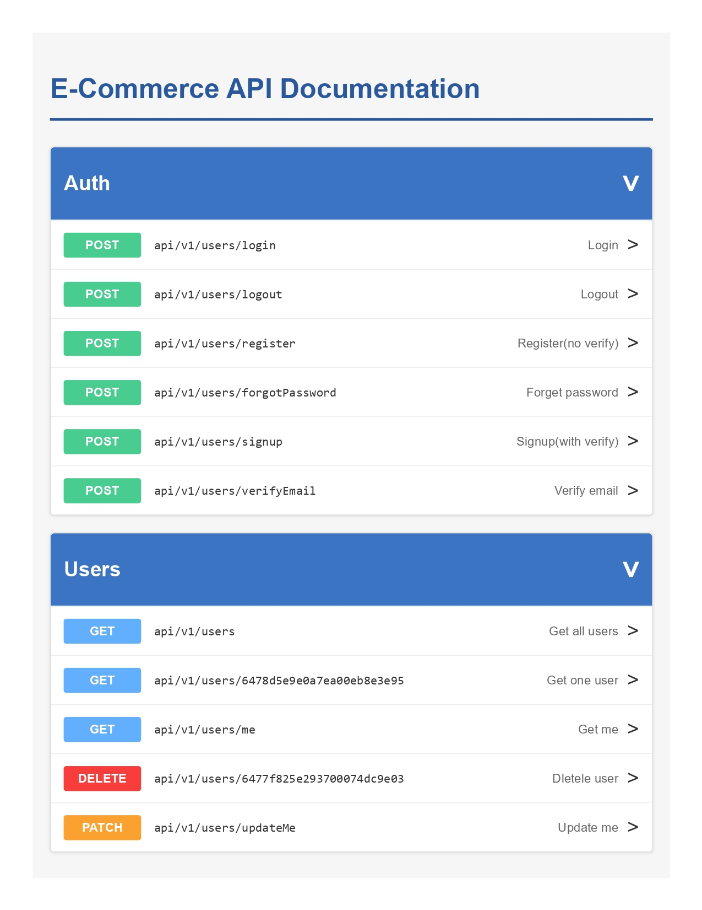
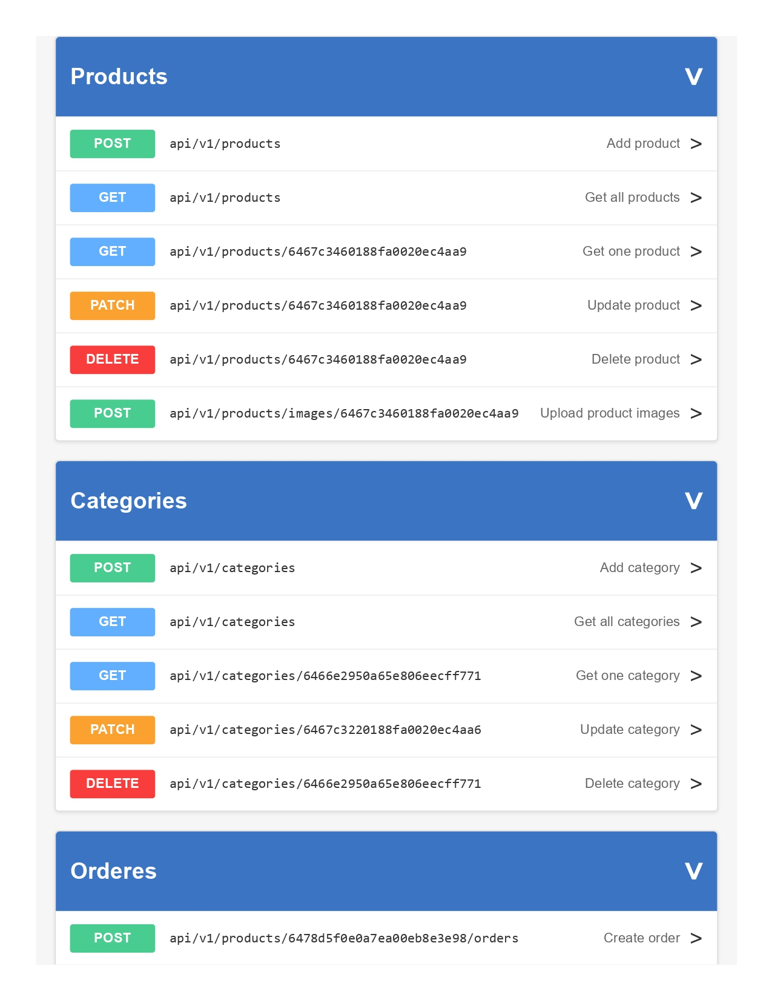
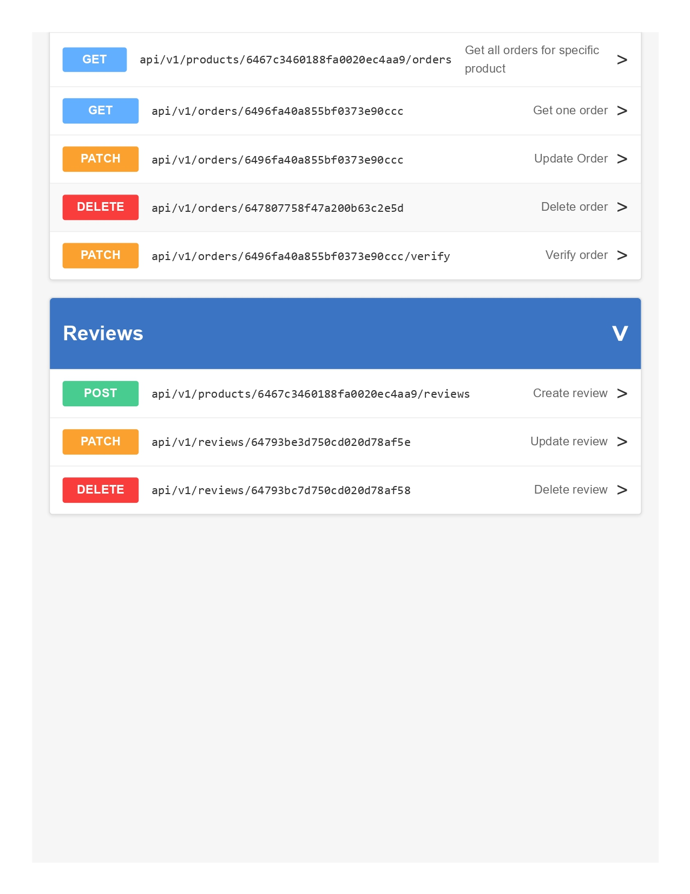

# E‑Commerce Project

A full‑stack e‑commerce application built with modern web technologies.

## Table of Contents

- [Overview](#overview)  
- [Features](#features)  
- [Tech Stack](#tech-stack)  
- [Architecture / Folder Structure](#architecture--folder-structure)  
- [Setup & Installation](#setup--installation)  
- [Usage](#usage)  
- [API / Endpoints](#api--endpoints)  

---

## Overview

This project is a full e‑commerce platform where users can browse products, add to cart, checkout, manage profile orders, and (optionally) an admin panel to manage products, orders, users etc.

## Features

- User registration, login, logout  
- Product listing, filtering, search  
- Product details  
- Shopping cart & checkout  
- Order history / user profile  
- Email notifications  

## Tech Stack

| Layer | Technology |
|---|---|
| Backend | Node.js, Express.js |
| Database | MongoDB |
| ORM / ODM | Mongoose |
| Authentication | JWT |
| Dev / Ops | Docker, Docker Compose |

## Architecture / Folder Structure

```
├──app
│   ├── src/
│   ├── controllers/
│   ├── models/
│   ├── routes/
│   ├── services/
│   └── utils/
├── docker-compose.yml

```

## Setup & Installation

### Prerequisites


- Docker & Docker Compose 
### Steps

```bash
docker-compose up --build
```

Visit `http://localhost:3000` in your browser.

## Usage

- Register or login  
- Browse products  
- Add to cart  
- Checkout  
- View orders  


## API / Endpoints




